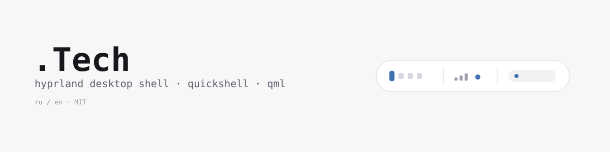
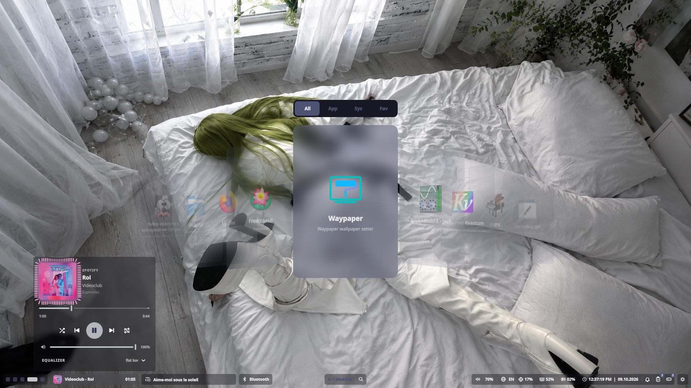
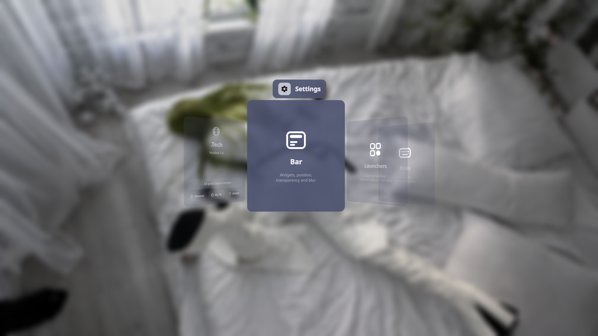
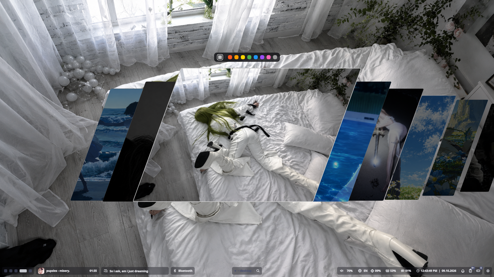

<div align="center">

# .Tech

**Мой шелл для Hyprland на Quickshell**
*My Hyprland desktop shell, built on Quickshell*

<picture>
  <source media="(prefers-color-scheme: dark)" srcset="assets/Screens/banner-dark.svg">
  <source media="(prefers-color-scheme: light)" srcset="assets/Screens/banner-light.svg">
  
</picture>

[](LICENSE)
[](https://hypr.land)
[](https://quickshell.org)
[](#обновление)

<sub>Собрано вручную, баг за багом, апдейт за апдейтом · Handbuilt, bug by bug, update by update</sub>

[Русский](#русский) · [English](#english)

</div>







---

## Русский

### Что это

`.Tech` — рабочий стол для [Hyprland](https://hypr.land), целиком на QML и [Quickshell](https://quickshell.org). Панель, всплывающие окошки, лаунчеры, уведомления, настройки. Есть русский и английский.

Я делаю его под себя и выкладываю как есть, так что углы местами шершавые. Нашёл баг или есть идея — заводи [issue](https://github.com/22miligrams-cmyk/.Tech/issues), мне важно.

<p align="center"><sub>⬇ дальше: возможности → установка → мини-туториалы → остальное ⬇</sub></p>

### ✨ Возможности

<details open>
<summary><b>Панель и лаунчеры</b></summary>

- **Панель (Bar)** из отдельных блоков-плашек: системный монитор, часы, язык, трей, батарея, сеть и т.д. Соседние блоки можно склеивать в одну капсулу.
- **Редактор раскладки** прямо в настройках — блоки таскаются мышкой между зонами лево/центр/право, порядок внутри зоны тоже меняется перетаскиванием.
- **Режим «остров»** — переключатель: либо панель плавает отдельными плашками, либо прижимается к краям экрана сплошной полосой.
- **Лаунчер приложений** с размытием на собственном шейдере (`bar_blur.frag`), тот же шейдер, что и у панели — никакого размытия от композитора.
- **Выбор обоев** со своим превью-гридом.

</details>

<details open>
<summary><b>Обои и цвета</b></summary>

- Цветовая схема вытаскивается **из самих обоев** (`color.py` → `colors.json` / `palettes.json`), шелл перекрашивается целиком следом.
- Поддержка нескольких палитр на одни обои.

</details>

<details open>
<summary><b>Панели и виджеты</b></summary>

- **Центр уведомлений** и всплывающие нотификации с «Не беспокоить», который реально глушит звук (даже у мессенджеров — через PipeWire).
- **Календарь** с заметками и будильниками, включая будильники «на один раз».
- **Плеер (MPRIS)** с кольцом из «прыгающих» полосок вокруг обложки, которое реагирует на настоящий звук системы (20 полос, без cava).
- **Тексты песен / караоке** с автоматической подгрузкой LRC.
- **Буфер обмена** — горизонтальная карусель карточек с текстом и картинками, история сохраняется.
- **Обзор рабочих столов** с живыми превью окон (без рамок, тонкая полоска вместо больших цифр).
- **Alt+Tab** в стиле Windows — переключение окон по удержанию модификатора.
- **Центр управления**: громкость, Bluetooth, системный монитор, трей — всё в один клик.
- **Экран блокировки.**

</details>

<details open>
<summary><b>Под капотом</b></summary>

- **Самообновление**: шелл сам проверяет GitHub и предлагает обновиться прямо из настроек, уведомление об апдейте пробивает «Не беспокоить».
- Свои **шейдеры** (размытие, эффект воды) вместо эффектов композитора.
- **Параллакс** можно включать/выключать отдельно для каждой панели через IPC.
- Полностью **двуязычный интерфейс** (RU/EN), один клик — и всё переведено.

</details>

### Что нужно, чтобы это завелось

- **Hyprland 0.55+** (с этой версии конфиг на Lua, `hyprland.lua`; старый `hyprland.conf` тоже работает)
- **Quickshell**
- Wayland и PipeWire

Остальное установщик проверит сам и предложит доставить: `git`, `curl`, `jq`, `python3`, `wireplumber`, `pavucontrol`, `blueman`, `xdg-utils`, `fontconfig`, `qt6-shadertools` и шрифт **JetBrainsMono Nerd Font** (без него вместо иконок будут квадратики).

### Установка

Одной командой:

```bash
curl -fsSL https://raw.githubusercontent.com/22miligrams-cmyk/.Tech/main/install.sh | bash
```

Если не хочешь запускать что попало из интернета (и правильно), скачай `install.sh`, прочитай и запусти: `bash install.sh`.

**Как это пройдёт:**

1. Выбираешь язык: русский или English.
2. Установщик смотрит, какой у тебя дистрибутив (Arch, Debian/Ubuntu, Fedora, openSUSE) и какая версия Hyprland.
3. Показывает, чего не хватает. ✔ — есть, ✘ — нет, но поставлю, ! — в репозиториях нет, ставь руками.
4. Появляется меню шагов. Стрелки ↑↓ двигают, **пробел** включает и выключает пункт, **Enter** запускает. Что уже сделано (шрифт, цвета…), помечено и пропускается.
5. Дальше он сам: ставит пакеты, качает шелл в `~/.tech/shell`, собирает шейдеры, создаёт стартовые цвета, добавляет автозапуск и запускает шелл.
6. Один вопрос по дороге: **проверять ли обновления автоматически**. Потом это можно поменять (см. «Обновление»).

> `quickshell` на разных системах ставится по-разному. Arch: из репозиториев или AUR (`yay`/`paru`). Fedora: из COPR `errornr/quickshell`. Debian/Ubuntu: в репозиториях его нет, придётся ставить руками по [инструкции](https://quickshell.org).

**Флаги установщика**

| Флаг | Что делает |
|---|---|
| `-y`, `--yes` | без вопросов, всё автоматически |
| `--dry-run` | ничего не менять, только показать, что будет |
| `--auto-update` / `--no-auto-update` | сразу включить или выключить проверку обновлений |
| `-h`, `--help` | справка |

Через `curl | bash` флаги передаются так: `curl -fsSL …/install.sh | bash -s -- -y`

**Переменные:** `TECH_LANG=ru` или `en` (язык без вопроса), `TECH_DIR=/путь` (куда ставить, по умолчанию `~/.tech/shell`).

### 🧭 Мини-туториалы

Коротко — как делать самое частое. Всё это доступно сразу после установки, ничего отдельно настраивать не нужно.

<details>
<summary><b>Переставить блоки на панели</b></summary>

1. Открой настройки → карточка раскладки панели.
2. Там три зоны — **лево / центр / право** — и плашка на каждый блок панели.
3. Тащи плашку мышкой в нужную зону или на новое место внутри зоны — порядок меняется сразу.
4. Хочешь склеить два соседних блока в одну капсулу — кликни между ними.
5. Плашки не влезают с подписями — редактор сам уйдёт в компактный режим (только иконки).
6. Выключить блок совсем, но запомнить его место — переключатель рядом с плашкой.

</details>

<details>
<summary><b>Включить режим «остров»</b></summary>

В тех же настройках панели — переключатель **«Остров»** (включён по умолчанию).
- **Включено** — блоки панели плавают отдельными плашками с отступами от края.
- **Выключено** — плашки одной группы вытягиваются до самого края экрана, ближний к краю угол становится прямым. Позиция блоков при этом не меняется.

</details>

<details>
<summary><b>Поменять обои и получить новую палитру</b></summary>

1. Открой выбор обоев (лаунчер обоев в баре или по IPC, см. ниже).
2. Выбери картинку — она станет обоями, и следом автоматически посчитается новая палитра (`colors.json`), шелл перекрасится.
3. Палитру можно поменять и руками — она лежит в `~/.cache/quickshell/colors.json`, ключи `bg`, `accent`, `text`, `secondary`. Сохранил файл — цвета обновились сами, перезапускать шелл не нужно.

</details>

<details>
<summary><b>Не пропустить важное во время «Не беспокоить»</b></summary>

«Не беспокоить» в настройках режет все обычные уведомления и глушит звук мессенджеров через PipeWire. Но два исключения специально пробивают его:
- уведомление о новой версии шелла;
- будильник из календаря.

Включить/выключить DND можно и из терминала: `quickshell ipc -p ~/.tech/shell call shell dnd`.

</details>

<details>
<summary><b>Поставить будильник «на один раз»</b></summary>

1. Открой календарь.
2. Добавь напоминание и выбери тип «на один раз» вместо повторяющегося.
3. В момент срабатывания появится отдельное всплывающее окно поверх всего — оно пробивает «Не беспокоить», так что не пропустишь.

</details>

<details>
<summary><b>Посмотреть, как плеер реагирует на звук</b></summary>

Просто включи что-нибудь со звуком и открой панель плеера (значок трека в баре или `quickshell ipc -p ~/.tech/shell call shell player`). Кольцо вокруг обложки альбома само начнёт прыгать в такт — оно слушает реальный звук системы через PipeWire, никакой отдельной настройки не требуется.

</details>

<details>
<summary><b>Открывать панели с клавиатуры</b></summary>

Все панели открываются одной IPC-командой, значит на них легко повесить хоткеи в `hyprland.lua`/`hyprland.conf`. Общий вид:

```bash
quickshell ipc -p ~/.tech/shell call shell <команда>
```

| Команда | Что открывает |
|---|---|
| `calendar` | Календарь |
| `volume` | Громкость |
| `player` | Плеер (MPRIS) |
| `lyrics` | Текст песни / караоке |
| `notifications` | Центр уведомлений |
| `clipboard` | Буфер обмена |
| `tray` | Системный трей |
| `bluetooth` | Bluetooth |
| `workspaces` | Обзор рабочих столов |
| `settings` | Настройки |
| `controlCenter` | Центр управления |
| `alttab` / `alttabPrev` | Alt+Tab вперёд / назад |
| `dnd` | Переключить «Не беспокоить» |

Пример бинда (Hyprland 0.55+, `hyprland.lua`):

```lua
hl.bind("SUPER", "V", "exec", "quickshell ipc -p ~/.tech/shell call shell clipboard")
```

Старый формат (`hyprland.conf`):

```ini
bind = SUPER, V, exec, quickshell ipc -p ~/.tech/shell call shell clipboard
```

</details>

### Обновление

Шелл сам следит за новыми версиями, тебе почти ничего делать не надо.

**Как он узнаёт о новой версии**
- через 20 секунд после запуска и потом раз в несколько часов сравнивает твой `v.version` с тем, что на GitHub;
- **каждый раз, когда ты открываешь настройки**, тихо проверяет ещё раз (без уведомлений, просто чтобы показать свежий статус).

**Что ты увидишь**
- Вышла новая версия — прилетит уведомление «Йоу, есть апдейт!». Оно **пробивает «Не беспокоить»**, чтобы ты точно заметил. Напомнит оно один раз за запуск шелла, пока не обновишься.
- Открой настройки: первая карточка **«О шелле»** показывает версию, статус и ссылки.
  - Есть обновление — на ней кнопка **«Обновить до N»**. Нажимаешь, открывается терминал с установщиком, он всё сделает.
  - Всё свежее — там написано «✓ Всё ок, последняя версия».

**Если не хочешь, чтобы шелл лез на GitHub сам**, выключи автопроверку (ручная проверка и карточка «О шелле» продолжат работать):

```bash
quickshell ipc -p ~/.tech/shell call updater autoOff   # выключить
quickshell ipc -p ~/.tech/shell call updater autoOn    # включить обратно
```

**Остальные команды**

```bash
quickshell ipc -p ~/.tech/shell call updater check     # проверить прямо сейчас
quickshell ipc -p ~/.tech/shell call updater status    # что сейчас известно о версиях
quickshell ipc -p ~/.tech/shell call updater apply     # открыть терминал и запустить установщик
quickshell ipc -p ~/.tech/shell call updater autoToggle
```

Настройки (автопроверка, период в часах) лежат в `~/.cache/qs-updater/state.json`.

**Обновить можно и вручную:** просто запусти установщик ещё раз.
- версии совпали — предложит выйти или переустановить;
- на GitHub новее — предложит обновиться (новая копия скачается рядом, и только потом заменит старую, поэтому обрыв интернета ничего не сломает);
- GitHub недоступен — сделает обычный `git pull`.

⚠️ Если ты правил файлы шелла руками, при обновлении они **пропадут**. Установщик предупредит об этом.

Перезапустить шелл: `pkill -x quickshell && quickshell -d -p ~/.tech/shell`

### Автозапуск

Установщик добавляет его сам (и делает бэкап `*.bak-<дата>`). Руками это выглядит так.

**Hyprland 0.55+, `~/.config/hypr/hyprland.lua`:**

```lua
hl.on("hyprland.start", function()
  hl.exec_cmd("quickshell -p '/home/USER/.tech/shell'")
end)
```

**Старый формат, `~/.config/hypr/hyprland.conf`:**

```ini
exec-once = quickshell -p '/home/USER/.tech/shell'
```

### Ручная установка

Без установщика:

1. Поставь зависимости и JetBrainsMono Nerd Font.
2. Склонируй репозиторий:
   ```bash
   git clone https://github.com/22miligrams-cmyk/.Tech.git ~/.tech/shell
   ```
3. Собери шейдеры:
   ```bash
   cd ~/.tech/shell
   find . -type f \( -name '*.frag' -o -name '*.vert' \) -exec sh -c 'qsb --qt6 -o "$1.qsb" "$1"' _ {} \;
   ```
4. Положи стартовые цвета в `~/.cache/quickshell/colors.json`:
   ```json
   {
     "bg": "#181825",
     "accent": "#a3cef1",
     "text": "#e0e1dd",
     "secondary": "#3d5a80"
   }
   ```
5. Запусти: `quickshell -d -p ~/.tech/shell`

### Цвета

Палитра берётся из `~/.cache/quickshell/colors.json` (ключи `bg`, `accent`, `text`, `secondary`). Поменял значения — цвета обновились.

### Что где лежит

```
shell.qml        точка входа
Bar.qml          панель
Logic.qml        логика и состояние
Visual.qml       сборка интерфейса
v.version        версия (по ней работает обновление)
assets/ icons/   ресурсы и иконки
bar/ panels/     панель и всплывающие окошки
launchers/       лаунчеры
notifications/   уведомления
settings/        настройки (в том числе карточка «О шелле»)
updater/         проверка и установка обновлений
lang/            переводы (LangRu.qml, LangEn.qml)
lrc/             тексты песен
common/          общие компоненты
```

### Если что-то не работает

| Проблема | Что делать |
|---|---|
| Шелл не стартует или выглядит криво | Запусти без `-d`, ошибки QML будут видны: `quickshell -p ~/.tech/shell` |
| Вместо иконок квадратики | Нет JetBrainsMono Nerd Font. Запусти установщик ещё раз |
| Не хватает пакета | Запусти установщик ещё раз, он покажет, чего нет |
| Шейдеры не собрались | Поставь `qsb` (пакет `qt6-shadertools`) |
| Шелл не стартует при входе | Проверь, что в `hyprland.lua` или `hyprland.conf` есть строка с `quickshell` |
| Обновление не показывается | `quickshell ipc -p ~/.tech/shell call updater check`, потом `… call updater status`. Если пишет `error`, шелл не достучался до GitHub |
| `ipc` пишет «could not find config» | Используй `-p ~/.tech/shell`, как в примерах выше |

### Для тех, кто форкает или выпускает обновления

Обновление срабатывает, когда число в `v.version` на GitHub **больше**, чем у пользователя. Поэтому, чтобы выпустить версию:

```bash
echo 4 > v.version
git add -A
git commit -m "что изменилось"
git pull --rebase origin main && git push origin main
```

`install.sh` лежит в корне репозитория, но в `~/.tech/shell` не копируется. Если правишь его, добавляй с флагом: `git add --sparse install.sh`.

### Удаление

```bash
pkill -x quickshell
rm -rf ~/.tech/shell ~/.cache/qs-updater
rm -f ~/.config/quickshell/tech
```

И убери блок `.Tech shell` из `hyprland.lua` или `hyprland.conf`. Бэкапы `.bak-<дата>` лежат рядом, можно просто вернуть.

### Лицензия

[MIT](LICENSE)

---

## English

### What is this

`.Tech` is a desktop shell for [Hyprland](https://hypr.land), written entirely in QML on [Quickshell](https://quickshell.org): bar, popup panels, launchers, notifications, settings. The UI comes in Russian and English.

I build it for myself and share it as is, so some edges are rough. Found a bug or have an idea? Open an [issue](https://github.com/22miligrams-cmyk/.Tech/issues).

<p align="center"><sub>⬇ next up: features → install → mini tutorials → the rest ⬇</sub></p>

### ✨ Features

<details open>
<summary><b>Bar & launchers</b></summary>

- **Bar** built from separate pill blocks: system monitor, clock, language, tray, battery, network and more. Neighboring blocks can be merged into one capsule.
- **Layout editor** right inside settings — drag blocks between the left/center/right zones, reorder within a zone by dragging too.
- **"Island" mode** toggle — either the bar floats as separate pills, or it hugs the screen edges as one continuous strip.
- **App launcher** blurred with its own custom shader (`bar_blur.frag`), the same one the bar uses — no compositor blur involved.
- **Wallpaper picker** with its own preview grid.

</details>

<details open>
<summary><b>Wallpapers & color</b></summary>

- The color scheme is extracted **straight from your wallpaper** (`color.py` → `colors.json` / `palettes.json`), and the whole shell recolors to match.
- Multiple palettes per wallpaper are supported.

</details>

<details open>
<summary><b>Panels & widgets</b></summary>

- **Notification center** and pop-up notifications, with a Do Not Disturb that actually mutes audio (even messenger sounds, via PipeWire).
- **Calendar** with notes and alarms, including one-shot "fire once" alarms.
- **Media player (MPRIS)** with a ring of bars around the album art that jumps to real system audio (20 bands, no cava).
- **Lyrics / karaoke** panel with automatic LRC fetching.
- **Clipboard manager** — a horizontal carousel of text and image cards, with history.
- **Workspaces overview** with live window thumbnails (no borders, a thin stripe instead of big numbers).
- **Windows-style Alt+Tab** window switching.
- **Control Center**: volume, Bluetooth, system monitor, tray — all in one place.
- **Lock screen.**

</details>

<details open>
<summary><b>Under the hood</b></summary>

- **Self-updating**: the shell checks GitHub on its own and offers to update right from Settings; the update notification breaks through Do Not Disturb.
- Custom **shaders** (blur, a water effect) instead of compositor effects.
- **Parallax** can be toggled per panel over IPC.
- Fully **bilingual UI** (RU/EN) — one click and everything's translated.

</details>

### What you need

- **Hyprland 0.55+** (the config is Lua, `hyprland.lua`, from that version; the old `hyprland.conf` still works)
- **Quickshell**
- Wayland and PipeWire

The installer checks everything else and offers to install what's missing: `git`, `curl`, `jq`, `python3`, `wireplumber`, `pavucontrol`, `blueman`, `xdg-utils`, `fontconfig`, `qt6-shadertools`, plus **JetBrainsMono Nerd Font** (without it icons show up as boxes).

### Install

One command:

```bash
curl -fsSL https://raw.githubusercontent.com/22miligrams-cmyk/.Tech/main/install.sh | bash
```

Or download `install.sh`, read it, and run `bash install.sh`.

**What happens:**

1. You pick a language.
2. It detects your distro (Arch, Debian/Ubuntu, Fedora, openSUSE) and Hyprland version.
3. It shows what's missing. ✔ found, ✘ missing and will be installed, ! not in the repos, install by hand.
4. A step menu appears: **↑↓** to move, **Space** to toggle, **Enter** to start. Steps already done are marked and skipped.
5. Then it installs packages, downloads the shell to `~/.tech/shell`, builds shaders, creates starter colors, adds autostart and launches the shell.
6. One question on the way: **check for updates automatically?** You can change it later (see "Updates").

`quickshell` comes from the repos or AUR on Arch, from the `errornr/quickshell` COPR on Fedora, and has to be installed by hand on Debian/Ubuntu (see the [instructions](https://quickshell.org)).

**Flags:** `-y` / `--yes` (no questions), `--dry-run` (change nothing, just show), `--auto-update` / `--no-auto-update` (answer the update question up front), `--help`. With `curl | bash`: `… | bash -s -- -y`.
**Env:** `TECH_LANG=ru|en`, `TECH_DIR=<install dir>`.

### 🧭 Mini tutorials

The quick version of the most common things. All of this works right after install — nothing extra to set up.

<details>
<summary><b>Rearrange bar blocks</b></summary>

1. Open Settings → the bar layout card.
2. You'll see three zones — **left / center / right** — and a tile for each bar block.
3. Drag a tile into another zone, or to a new spot in the same zone — the order updates live.
4. Want to merge two neighboring blocks into one capsule? Click the gap between them.
5. If labeled tiles don't fit, the editor drops into compact mode (icons only) automatically.
6. Turn a block off entirely while keeping its spot remembered — use the toggle next to its tile.

</details>

<details>
<summary><b>Turn on "island" mode</b></summary>

Same bar settings card — the **"Island"** toggle (on by default).
- **On** — bar blocks float as separate pills with padding from the screen edge.
- **Off** — blocks in a group stretch all the way to the edge, and the edge-side corner of the group goes square. Block position otherwise stays the same.

</details>

<details>
<summary><b>Change wallpaper and get a new palette</b></summary>

1. Open the wallpaper picker (from the bar, or over IPC — see below).
2. Pick an image — it becomes your wallpaper, and a new palette (`colors.json`) is computed right after, recoloring the shell.
3. You can also edit the palette by hand — it lives at `~/.cache/quickshell/colors.json`, keys `bg`, `accent`, `text`, `secondary`. Save the file and the colors update on their own, no restart needed.

</details>

<details>
<summary><b>Don't miss anything important during Do Not Disturb</b></summary>

Do Not Disturb (in Settings) blocks regular notifications and mutes messenger audio over PipeWire. Two things are deliberately allowed through anyway:
- the shell-update notification;
- a calendar alarm.

You can also toggle DND from a terminal: `quickshell ipc -p ~/.tech/shell call shell dnd`.

</details>

<details>
<summary><b>Set a one-shot alarm</b></summary>

1. Open the calendar.
2. Add a reminder and pick "once" instead of a repeating schedule.
3. When it fires, a dedicated pop-up appears on top of everything — it breaks through Do Not Disturb, so you won't miss it.

</details>

<details>
<summary><b>See the player react to audio</b></summary>

Play anything with sound and open the player panel (the track icon in the bar, or `quickshell ipc -p ~/.tech/shell call shell player`). The ring around the album art starts jumping with the beat on its own — it listens to real system audio over PipeWire, nothing else to configure.

</details>

<details>
<summary><b>Open panels from the keyboard</b></summary>

Every panel opens with one IPC call, so it's easy to bind hotkeys for them in `hyprland.lua` / `hyprland.conf`. General shape:

```bash
quickshell ipc -p ~/.tech/shell call shell <command>
```

| Command | Opens |
|---|---|
| `calendar` | Calendar |
| `volume` | Volume |
| `player` | Media player (MPRIS) |
| `lyrics` | Lyrics / karaoke |
| `notifications` | Notification center |
| `clipboard` | Clipboard manager |
| `tray` | System tray |
| `bluetooth` | Bluetooth |
| `workspaces` | Workspaces overview |
| `settings` | Settings |
| `controlCenter` | Control Center |
| `alttab` / `alttabPrev` | Alt+Tab forward / back |
| `dnd` | Toggle Do Not Disturb |

Example bind (Hyprland 0.55+, `hyprland.lua`):

```lua
hl.bind("SUPER", "V", "exec", "quickshell ipc -p ~/.tech/shell call shell clipboard")
```

Legacy format (`hyprland.conf`):

```ini
bind = SUPER, V, exec, quickshell ipc -p ~/.tech/shell call shell clipboard
```

</details>

### Updates

The shell watches for new versions itself, so you rarely have to do anything.

**How it finds out**
- 20 seconds after start, and then every few hours, it compares your `v.version` with the one on GitHub;
- **every time you open Settings** it quietly checks again (no notification, just to show a fresh status).

**What you'll see**
- A new version is out: you get a "Yo, there's an update!" notification. It **breaks through Do Not Disturb** so you don't miss it, and it reminds you once per shell launch until you update.
- Open Settings: the first card, **About**, shows the version, the status and some links.
  - Update available: it has an **"Update to N"** button. Click it and a terminal opens with the installer, which does the rest.
  - Up to date: it says "✓ All good, latest version".

**Don't want the shell to contact GitHub on its own?** Turn auto-check off (manual check and the About card keep working):

```bash
quickshell ipc -p ~/.tech/shell call updater autoOff
quickshell ipc -p ~/.tech/shell call updater autoOn
```

**Other commands**

```bash
quickshell ipc -p ~/.tech/shell call updater check    # check right now
quickshell ipc -p ~/.tech/shell call updater status   # what is known about versions
quickshell ipc -p ~/.tech/shell call updater apply    # open a terminal and run the installer
```

Settings (auto-check, interval in hours) live in `~/.cache/qs-updater/state.json`.

**Manual update:** just run the installer again. Same version: it offers to exit or reinstall. GitHub is newer: it offers to update (the new copy is downloaded first and replaces the old one only after that). GitHub unreachable: plain `git pull`.

⚠️ Local edits to the shell files are **lost** on update. The installer warns you.

Restart the shell: `pkill -x quickshell && quickshell -d -p ~/.tech/shell`

### Autostart (manual)

The installer adds it for you (with a backup). By hand:

```lua
-- ~/.config/hypr/hyprland.lua  (Hyprland 0.55+)
hl.on("hyprland.start", function()
  hl.exec_cmd("quickshell -p '/home/USER/.tech/shell'")
end)
```

```ini
# ~/.config/hypr/hyprland.conf  (legacy)
exec-once = quickshell -p '/home/USER/.tech/shell'
```

### Manual install

Without the installer:

1. Install the dependencies and JetBrainsMono Nerd Font.
2. Clone the repo:
   ```bash
   git clone https://github.com/22miligrams-cmyk/.Tech.git ~/.tech/shell
   ```
3. Build the shaders:
   ```bash
   cd ~/.tech/shell
   find . -type f \( -name '*.frag' -o -name '*.vert' \) -exec sh -c 'qsb --qt6 -o "$1.qsb" "$1"' _ {} \;
   ```
4. Drop starter colors into `~/.cache/quickshell/colors.json`:
   ```json
   {
     "bg": "#181825",
     "accent": "#a3cef1",
     "text": "#e0e1dd",
     "secondary": "#3d5a80"
   }
   ```
5. Run it: `quickshell -d -p ~/.tech/shell`

### Colors

The palette comes from `~/.cache/quickshell/colors.json` (keys `bg`, `accent`, `text`, `secondary`). Change the values and the colors update.

### Where things live

```
shell.qml        entry point
Bar.qml          the bar
Logic.qml        logic and state
Visual.qml       UI assembly
v.version        version (drives updates)
assets/ icons/   assets and icons
bar/ panels/     bar and popup panels
launchers/       launchers
notifications/   notifications
settings/        settings (incl. the About card)
updater/         update checking and installing
lang/            translations (LangRu.qml, LangEn.qml)
lrc/             song lyrics
common/          shared components
```

### Troubleshooting

- Run the shell without `-d` to see QML errors: `quickshell -p ~/.tech/shell`
- Boxes instead of icons: JetBrainsMono Nerd Font is missing, run the installer again.
- Shaders not built: install `qsb` (`qt6-shadertools`).
- No update showing: run `… call updater check`, then `… call updater status`. `error` means GitHub couldn't be reached.
- `ipc` says it could not find the config: use `-p ~/.tech/shell` as in the examples.

### Releasing an update (for forks and for me)

An update triggers when the number in `v.version` on GitHub is **greater** than the user's:

```bash
echo 4 > v.version
git add -A
git commit -m "what changed"
git pull --rebase origin main && git push origin main
```

`install.sh` lives in the repo root but is not copied into `~/.tech/shell`; add it with `git add --sparse install.sh`.

### Uninstall

```bash
pkill -x quickshell
rm -rf ~/.tech/shell ~/.cache/qs-updater
rm -f ~/.config/quickshell/tech
```

Then remove the `.Tech shell` block from `hyprland.lua` / `hyprland.conf` (backups named `.bak-<date>` are right next to them).

### License

[MIT](LICENSE)
